# LoulouDo · 鹿鹿打卡 🦌

> 把孩子每天要做的小事，变成一场闪闪发光的金币冒险。

LoulouDo 是一款面向 4–10 岁孩子的**跨平台（iOS / Android / Web）打卡 App**：完成每日、周末、假期和特别挑战任务赚金币，金币按家庭约定的汇率兑换零花钱；家长可以在成长报表里看到习惯的变化。

整个 App 离线运行，数据只保存在本机，不登录、无广告。

## 🔗 在线体验

**<https://lulgabc.github.io/LoulouDo/>**

> GitHub Pages 版本；首次打开是引导页，数据保存在浏览器 localStorage 中。

---

## ✨ 核心功能

| 功能 | 说明 |
| --- | --- |
| ✅ 今日打卡 | 任务按类别自动出现；直接点击整个任务条完成/取消，带光效、粒子和震动反馈 |
| 🔁 固定任务 | 每日 / 周末 / 假期任务自动重复，不需要每天新建 |
| 🎯 单次挑战 | 带起止日期的“大任务”，完成后不再出现，奖励最高 |
| 📅 今日卡 | 大号单日日期 + 连续天数 + 推进进度；移除鹿头占位，自定义头像可选显示 |
| 🐷 小猪钱包 | 首页金币按钮改为小猪储蓄罐轮廓，金币余额与硬币图标并排显示 |
| 🎨 分类视觉 | 类别色分组标签 + 图标底色；所有任务收进一张任务板，不再每个任务一个盒子 |
| ✅ 完成交互 | 整行点击切换；金币移到右侧，未完成灰色、完成金色；完成行使用半透明圆点底纹 + 光带 + 粒子 |
| ✏️ 编辑方式 | 点击任务不会误入编辑；在「任务」页点铅笔按钮才编辑 |
| 🎁 全勤宝箱 | 当天所有任务完成，自动再奖励 5 金币（取消打卡会撤回） |
| 🔥 连续打卡 | 首页展示连续天数，跨天自动计算，断签重新开始 |
| 🪙 金币体系 | 四个类别不同默认奖励，可单独调整每个任务的奖励 |
| 💰 零花钱兑换 | 汇率可调（默认 10 金币 = ¥1），兑换记录进入“金币存折” |
| 🎁 心愿存钱罐 | 设置心愿和目标金额，用余额展示进度 |
| 🎨 4 套皮肤 | 糖果贴纸 / 森林贴纸 / 奇幻贴纸 / 可爱贴纸，全部即时切换 |
| 📊 成长报表 | 本周 / 本月 / 全部：金币柱状图、类别环图、完成率、最佳一天、家长小报告 |
| 🖼️ 自定义头像 | 从相册或图片链接选图，拖动 + 缩放裁剪成圆形头像；每次保存的历史头像留在本机可选 |
| 👨‍👩‍👧 多宝贝 | 一台设备可以给多个孩子分别记录任务、金币和报表 |
| 🏖️ 假期管理 | 自定义假期日期段，假期任务只在假期出现 |
| 🌍 七种语言 | 中文 / English / Français / Deutsch / Italiano / Español / Português，自动识别系统语言，随时切换 |
| 💾 本地持久化 | AsyncStorage 自动保存，刷新/重启不丢数据 |

### 任务规则

- **每日**：每天出现，默认 2 金币。
- **周末**：仅周六、周日出现，默认 5 金币。
- **假期**：仅在后台上设置的假期日期内出现，默认 6 金币。
- **特别挑战**：单次任务，在自己设定的日期窗口内完成一次，默认 15 金币。
- 固定任务按“日期 + 任务”记录完成；单次挑战全局只完成一次。
- 全勤金币、新手礼包等额外奖励会记录在存折中，和任务金币分开统计。

---

## 📱 界面一览

| 欢迎 & 选皮肤 | 今日打卡（森林贴纸） |
| --- | --- |
|  | 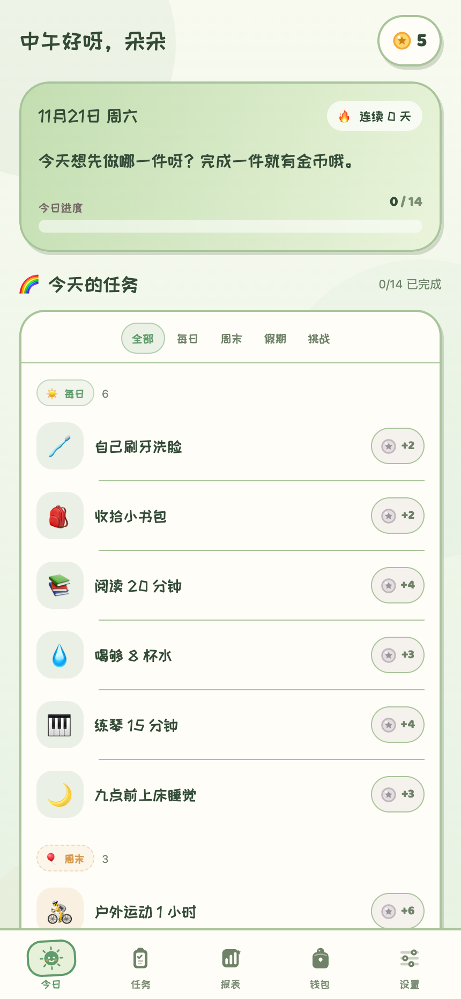 |

| 全部完成 + 彩纸 | 任务清单 |
| --- | --- |
|  |  |

| 成长报表 | 家长小报告 / 类别分析 |
| --- | --- |
|  | 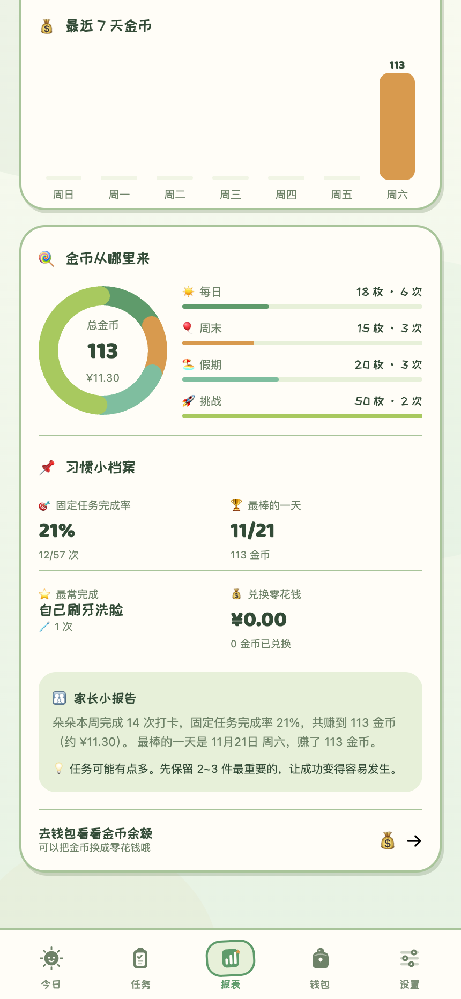 |

| 金币钱包 | 兑换零花钱 |
| --- | --- |
| 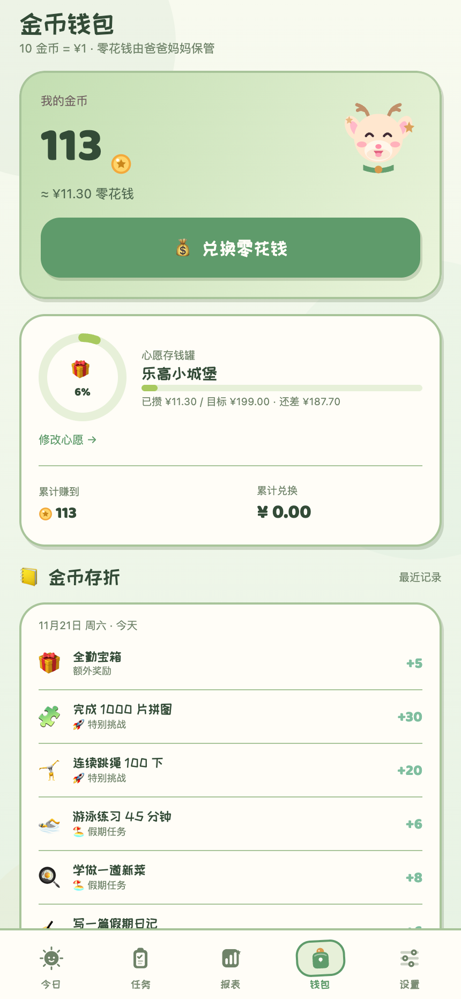 |  |

| 设置 & 皮肤 | 奇幻贴纸皮肤 |
| --- | --- |
| 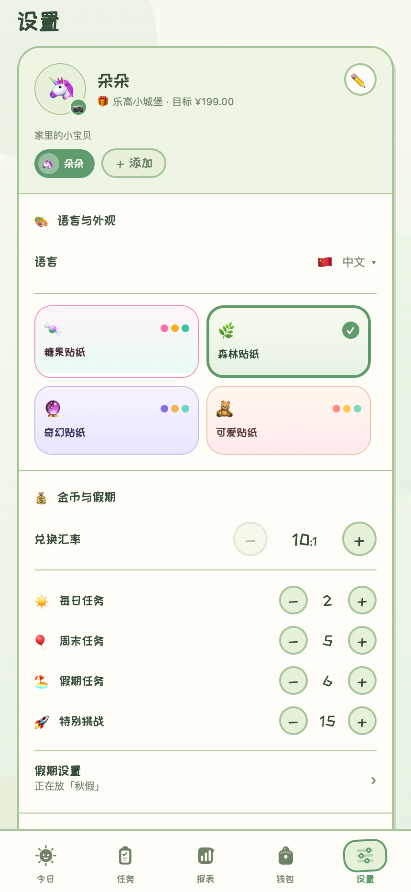 | 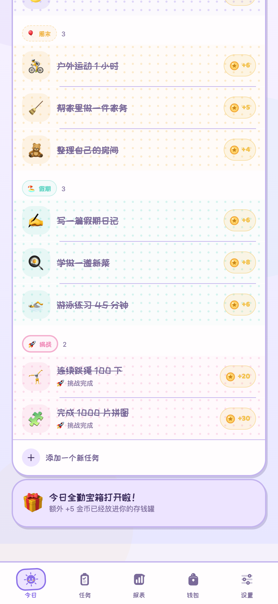 |

| 假期设置 | 任务编辑器 |
| --- | --- |
| 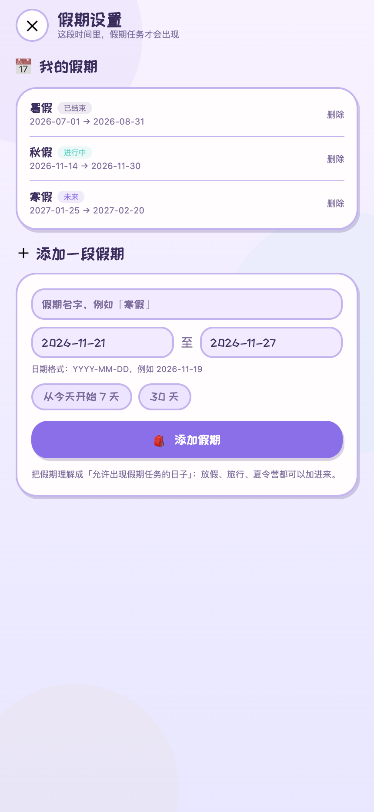 | 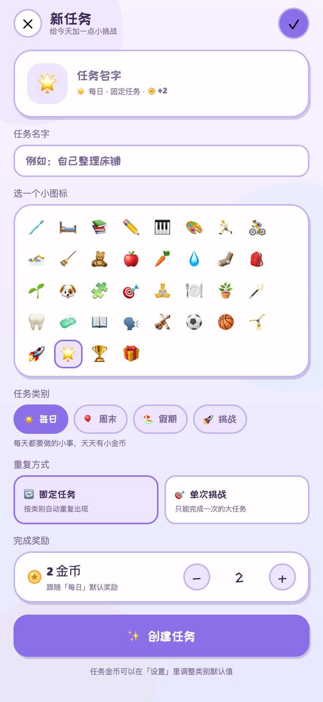 |

> 截图全部由 `scripts/screenshots.mjs` 用真实 Chrome 跑完整交互后自动生成（见文末验证）。

---

## 🖼️ 自定义头像

- 支持**相册图片**和**网络图片链接**两种来源；
- 圆形取景框内可**拖动选区域**，用 `− / +`（1×–3×）缩放；
- 保存时按当前取景裁剪成 320×320 方形小图，并转成压缩后的 data URI；
- 头像以**圆形**显示在首页、设置页、宝贝切换器和历史列表中；
- 每次保存都会加入「历史头像」，最多保留 12 个，全部存在本机 AsyncStorage；
- 可在历史头像中随时切换，也可以一键恢复 Emoji 头像。

| 裁剪 & 缩放 | 历史头像 |
| --- | --- |
| 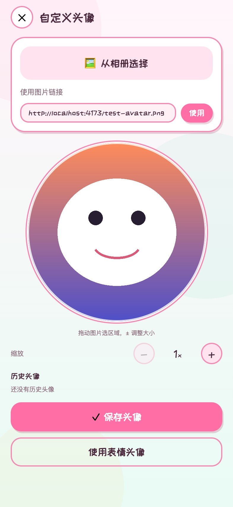 | 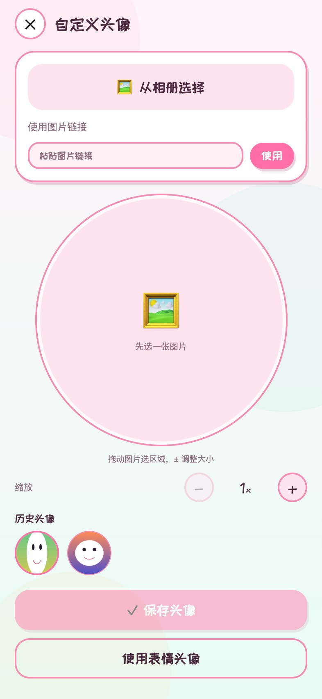 |

裁剪计算是纯函数（`src/domain/avatar.ts`），有 6 个边界测试覆盖横图、竖图、缩放、拖动和越界限制。

---

## 🌍 多语言

支持 **中文、English、Français、Deutsch、Italiano、Español、Português** 七种语言。

- 首次启动根据系统语言自动选择，可在引导页或设置里随时切换；
- 切换后，**示例任务、假期名称、心愿、历史存折标题**都会即时翻译（用户自己输入的内容保持原样）；
- 日期、星期、金额使用 `Intl` 按语言格式化（如 `Do., 19. Nov.`、`¥0,50`）；
- 中文使用站酷快乐体，其他语言自动切换到支持重音符号的 Baloo 2，避免 é / ü / ß 掉字；
- 语言包有完整性与占位符一致性测试，缺 key 会直接让 TypeScript / 测试失败。

| English · 首页 | Deutsch · 设置（320px） |
| --- | --- |
| 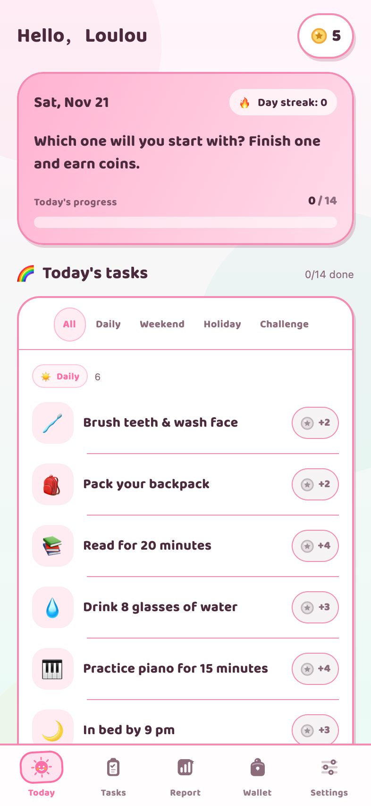 | 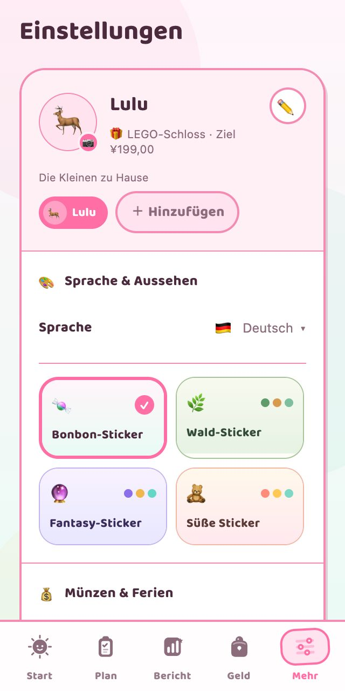 |

| Français · 首页（320px） | Português · 报表 |
| --- | --- |
| 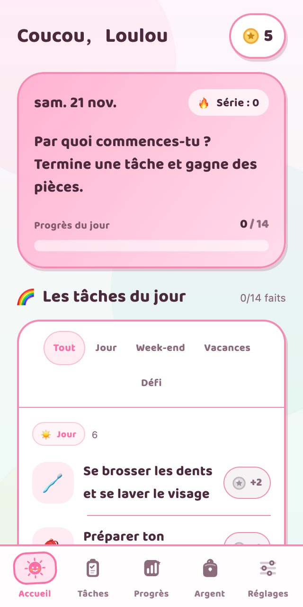 | 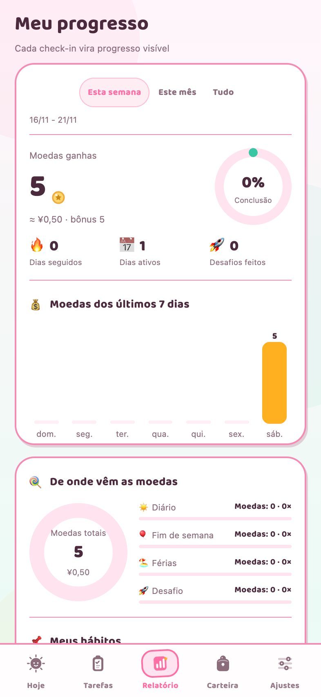 |

巡检结果（393 / 320 两种宽度 × 7 语言）：

- 0 条 console error；
- 0 横向溢出、0 文字裁切、0 输入框超出屏幕；
- 非中文界面 **0 中文残留**（语言选择器里的「中文」除外）；
- 兑换、任务编辑器、假期三个弹层在 EN / DE / FR / PT 的 320px 下同样 0 问题；
- 从 DE 切到 EN 后，示例任务与界面文案即时切换。

| 设置里的语言菜单 |
| --- |
| 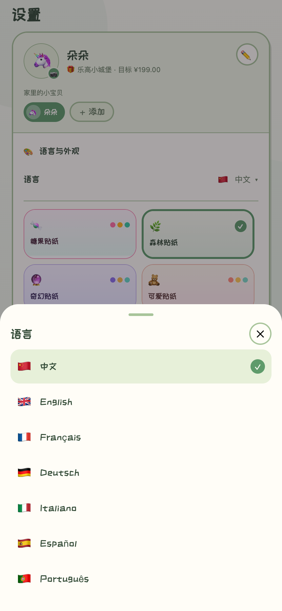 |

> 截图与机器可读结果：`docs/i18n/`、`docs/i18n/report.json`、`docs/i18n/modals-report.json`。
> 复跑：`npm run media:i18n`、`npm run media:i18n-modals`。

---

## 🎨 视觉系统 2.0

针对“方块堆积、缺少整体感”，这一版做了结构性重构，而不是只换颜色：

- **一张任务板，而不是 11 张卡片**：同一类任务收进同一个大面板，用留白、分组标签和细分隔线组织，减少边框和阴影的数量。
- **类别只用“标签/图标底色”表达**：每日粉、周末黄（虚线标签）、假期薄荷、挑战紫（双描边标签）；去掉行首色条，避免和 Emoji 图标重复，也不再满屏彩色边框。
- **统一的操作轨道**：首页筛选和报表时间范围都用同一个 Segmented，并直接嵌进第一张任务板/报表板内部，不再是悬浮的独立白条。
- **贴纸化的统一语言**：四套皮肤都使用 2px 贴纸描边 + 轻微硬阴影 + 大圆角，只用配色区分，不再混用不同材质。
- **背景去噪**：移除了满屏随机 Emoji 贴纸，改成 3 个低透明度的大色块，让内容成为主角。
- **报表 / 钱包 / 设置合并板块**：报表从 5 个卡片合并成 2 个 Board；钱包把“心愿 + 累计”合成一块；设置整页收进一个 Board，语言改为底部弹出菜单，皮肤改为紧凑缩略图，并删除重复说明文字。
- **底栏贴底全宽**：不再使用悬浮胶囊，TabBar 与屏幕同宽、贴底并带顶部发丝线；内部图标区最宽 560px 居中，和页面内容对齐。
- **排版收敛**：今日卡只保留“单日日期 / 连续天数 / 一句话鼓励 / 进度条”四层信息，去掉重复百分比和鹿头占位；任务行去掉对勾按钮，金币状态直接承担完成反馈。

参考的当下设计方向：Duolingo 2026 的 tab refresh 强调 *一致的头图与字号、尽量少的字体样式、用留白代替容器*；2026 移动端整体趋势仍是 *柔和大圆角、轻量层叠阴影、少边框、内容优先*。本项目保留了儿童向的糖果色和动效，但把这些原则落到一张任务板和一个统一控件体系里。

---

## 📐 手机适配巡检

针对 5 种设备尺寸逐一跑完所有页面（欢迎、首页、任务、报表、钱包、设置、兑换、任务编辑、假期），
自动检测横向溢出、输入框超出屏幕、页面级横向滚动，结果：

| 设备 | 视口 | 结果 |
| --- | --- | --- |
| iPhone 15 | 393 × 852 | ✅ 0 问题 / 0 console error |
| iPhone SE | 375 × 667 | ✅ 0 问题 / 0 console error |
| 小屏 Android | 360 × 740 | ✅ 0 问题 / 0 console error |
| 极小屏 | 320 × 568 | ✅ 0 问题 / 0 console error |
| iPad 竖屏 | 768 × 1024 | ✅ 0 问题 / 0 console error |

| 320 首页 | 320 报表 |
| --- | --- |
| 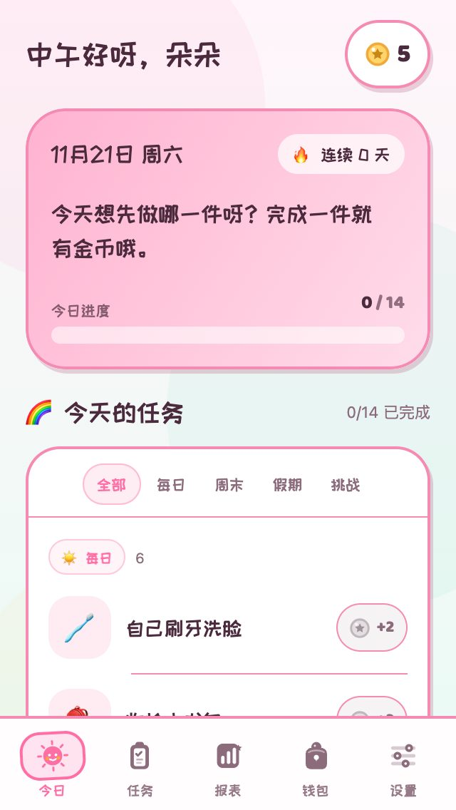 | 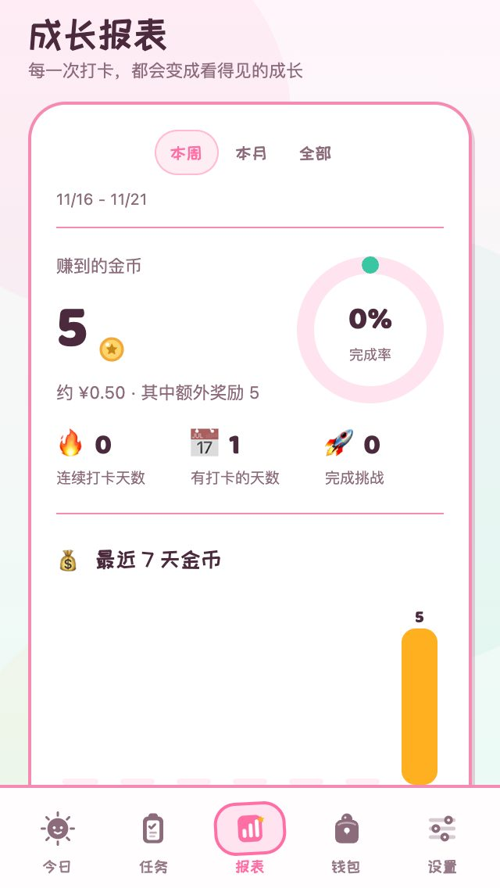 |

| 320 设置（双列皮肤） | 320 假期日期输入 |
| --- | --- |
| 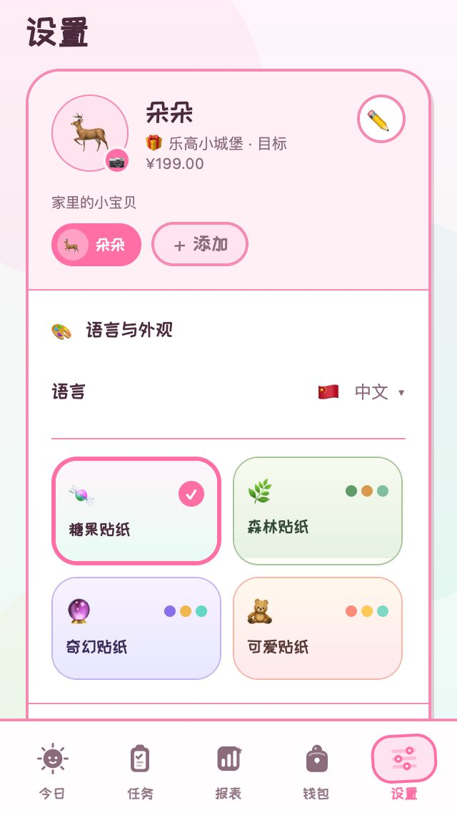 |  |

巡检中修掉的真实问题：

- 皮肤卡片宽度从 `48.5%` 改为 `48%`，避免 320/360 宽度下被挤成单列；
- “使用中”角标移到卡片右上角，不再压住皮肤描述；
- 假期开始/结束日期输入增加 `minWidth: 0`，窄屏不再溢出卡片；
- 长昵称在首页与设置页单行省略，不再挤压金币和编辑按钮；
- 平板/桌面端内容最宽 560px 居中，TabBar 贴底全宽、内部图标区同样居中；
- 所有页面底部预留 104px，滚动到底时最后一张卡片在 TabBar 上方。

> 全量截图在 `docs/mobile/`，机器可读结果在 `docs/mobile/layout-report.json`。
> 复跑：`npm run media:audit`（需先 `npm run export:web` 并启动 4173 静态服务）。

---

## 🚀 运行

```bash
npm install

# Web 预览
npm run web

# iOS / Android：用 Expo Go 扫描二维码
npm start
```

构建静态 Web：

```bash
npm run export:web   # 输出到 dist/
```

> 项目使用 Expo SDK 58 + React Native 0.88，纯 JS/TS 依赖，Expo Go 可直接运行；iOS/Android 原生工程未生成（`expo prebuild` 可生成）。

### 质量检查

```bash
npm run typecheck    # TypeScript 严格模式
npm test             # Vitest 领域逻辑测试
```

### 部署到 GitHub Pages

项目使用 `app.config.js` 读取 `EXPO_BASE_URL`，把资源前缀设为仓库子路径：

```bash
EXPO_BASE_URL=/LoulouDo npx expo export -p web --output-dir dist-pages
cp dist-pages/index.html dist-pages/404.html   # SPA 深链回退
touch dist-pages/.nojekyll                    # 保留 _expo 目录
# 将 dist-pages 推到 gh-pages 分支即可
```

当前线上版本：<https://lulgabc.github.io/LoulouDo/>

### 重新生成图标 / 演示截图

```bash
npm run media:icons
# 需要先 npm run export:web 并启动静态服务（端口 4173）
npm run media:shots
npm run media:i18n
npm run media:i18n-modals
```

---

## 🧠 设计与实现

### 架构

```text
app/                        Expo Router 页面（文件即路由）
  (tabs)/
    index.tsx               今日打卡
    tasks.tsx               任务清单（分类 / 编辑入口）
    report.tsx              成长报表
    wallet.tsx              金币钱包 + 存折
    settings.tsx            宝贝资料 / 皮肤 / 金币规则 / 假期
  welcome.tsx               首次启动引导
  task-editor.tsx           新建 / 编辑任务（Modal）
  redeem.tsx                兑换零花钱（Modal）
  holidays.tsx              假期日期段管理（Modal）
src/
  domain/                   纯函数领域层（可单测，不依赖 React）
    date.ts                 本地日期工具
    logic.ts                任务出现规则、金币、全勤、连续天数、报表统计
    seed.ts                 默认任务 / 假期 / 汇率
    constants.ts            类别、头像、Emoji、默认奖励
  store/AppStore.tsx        Context + useReducer + AsyncStorage 持久化
  theme/themes.ts           4 套皮肤 token + 字体
  components/               UI 基础组件 / 吉祥物 / 图表 / 彩纸 / 任务行 / 任务板 / 分段控件
tests/logic.test.ts         25 个领域逻辑测试
```

### 关键设计

1. **领域逻辑与 UI 完全分离**：任务是否出现、金币怎么算、连续天数、报表统计都是纯函数，因此边界情况（跨月、假期、单次挑战重复完成、全勤撤回）都能被单测覆盖。
2. **数据快照**：每条打卡记录保存当时的任务名、Emoji、类别、奖励和汇率，删除或修改任务不会篡改历史存折和报表。
3. **皮肤 token 化**：四套皮肤统一为贴纸语言，但各自定义背景渐变、卡片色、描边色、阴影色和强调色；糖果、森林、奇幻、可爱只在配色与氛围上区分。
4. **纯 SVG 吉祥物**：小鹿 Loulou 由 `react-native-svg` 绘制，支持开心/庆祝/困困三种表情，不依赖图片资源。
5. **儿童友好的反馈**：大按钮、Emoji 图标、彩纸雨、震动、连续天数、全勤宝箱和会说话的小鹿。
6. **本地优先**：AsyncStorage 持久化，无账号、无网络请求，适合家庭场景。

### 默认数据

首次启动会看到 15 个示例任务（6 每日、3 周末、3 假期、3 特别挑战）、秋假/寒假/暑假三段日期，以及 **10 金币 = ¥1** 的初始汇率（可在设置中修改）。所有这些都可以修改或删除。

> 默认汇率在 `src/domain/seed.ts` 中为 **10 金币 = ¥1**（见 `settings.rate`）。
> 兑换仅记录“家庭约定”的零花钱，不接入任何支付。

---

## ✅ 验证记录

在 macOS + Node 22 + Chrome 上实际执行：

```text
$ npx tsc --noEmit
（通过，无输出）

$ npx vitest run
Test Files  3 passed (3)
     Tests  41 passed (41)

$ npx expo export -p web
Exported: dist
```

端到端脚本（Playwright + 本机 Chrome）跑通：

- 首次引导 → 填写昵称 → 选择头像 → 切换“森林贴纸”皮肤 → 进入首页
- 完成当天全部任务 → 触发 **全勤宝箱**、连续 1 天和金币奖励
- 报表页完成率、类别分布、家长小报告正确渲染
- 钱包中使用 50 金币兑换 ¥5.00 → 余额 48，存折新增一条记录
- 切换到“奇幻贴纸”皮肤 → 进入假期页 → 新建任务“给植物浇水”
- 刷新页面 → 昵称、任务、皮肤（localStorage 中 `themeId: "fantasy"`）全部保留
- 全程 **0 条 console error / page error**
- 七语言巡检：非中文界面 0 中文残留，393/320 宽度下 0 溢出/裁切，三个弹层同样通过
- 头像：URL 选图 → 放大/拖动 → 保存 → 二次保存 → 历史切换 → 刷新后头像与两条历史仍在
- DE → EN 切换后，示例任务和存折标题即时翻译

---

## 📌 后续可以继续做

- 打卡提醒（本地通知）与睡前温柔提醒
- 家长 PIN / 家长模式，防止孩子自己改汇率
- 周报分享卡片、成就徽章、连续 7/30 天奖杯
- iCloud / 家庭共享同步
- 语音鼓励、自定义录音
- 更多皮肤与节日限定主题

---

Made with 🍬 for small humans and their big days.
