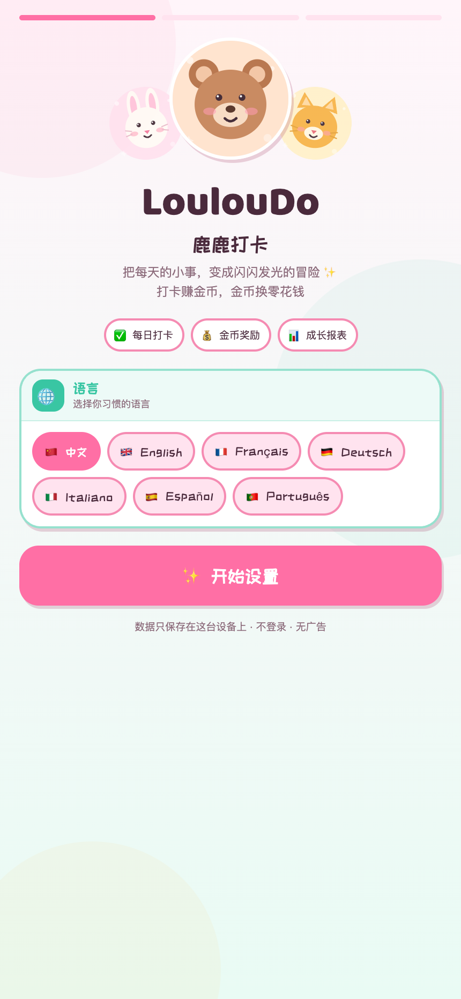
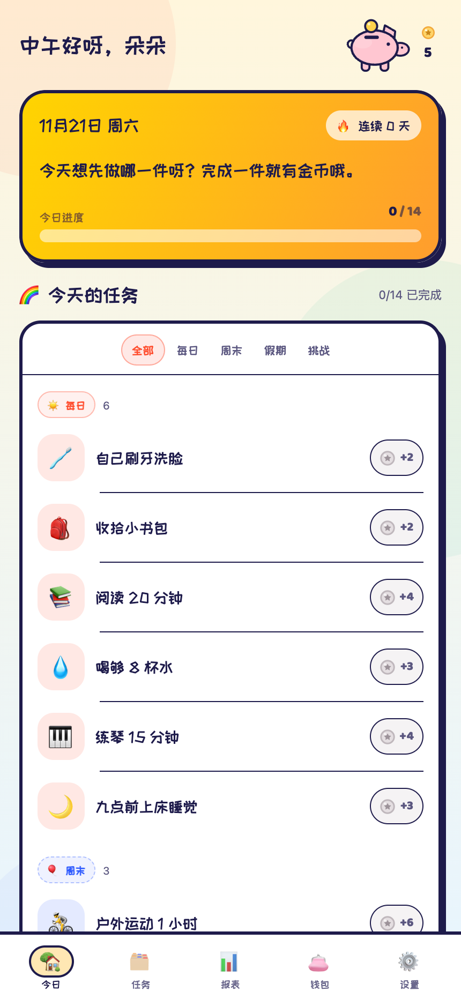
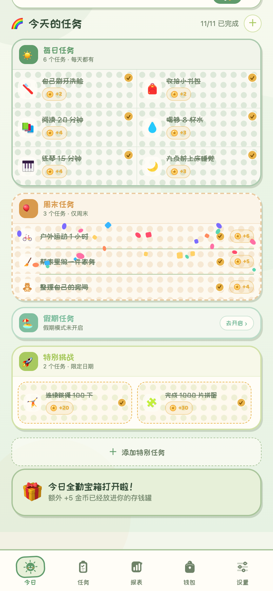
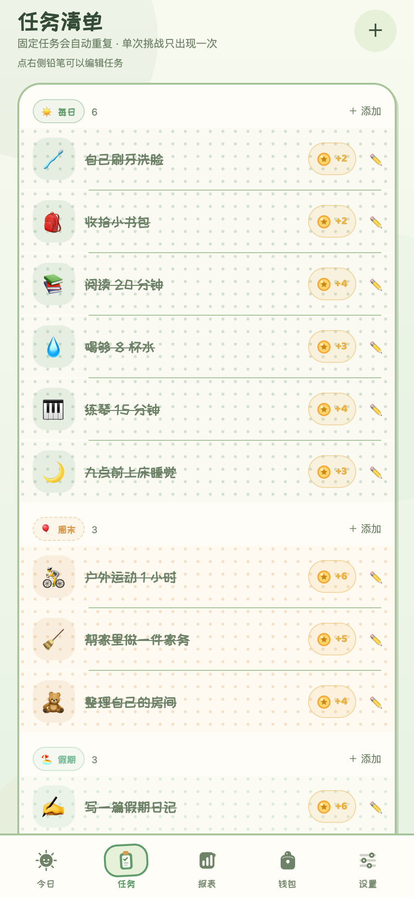
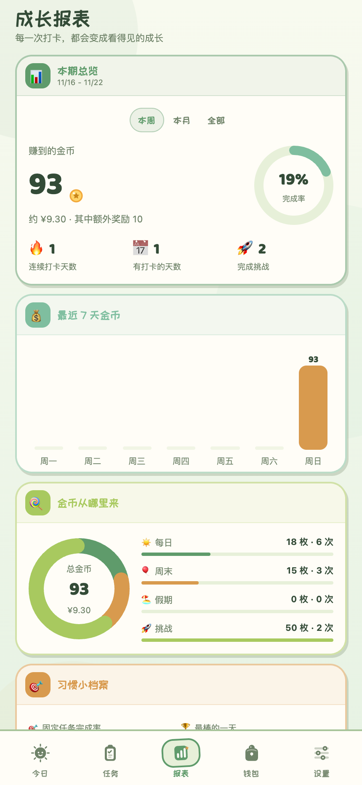
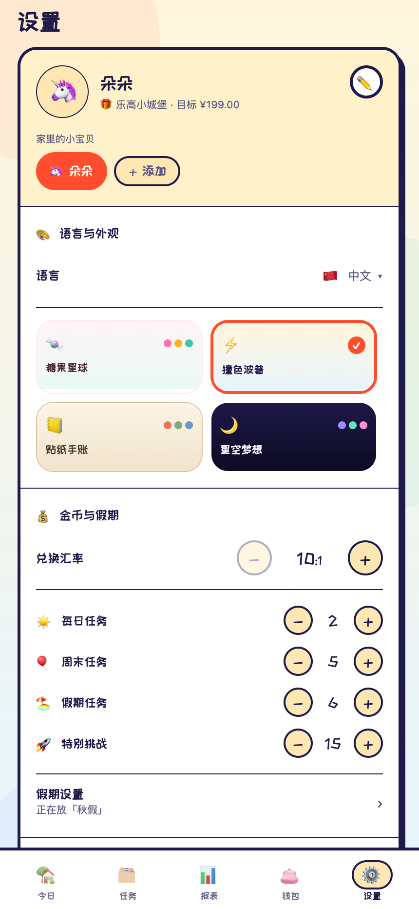
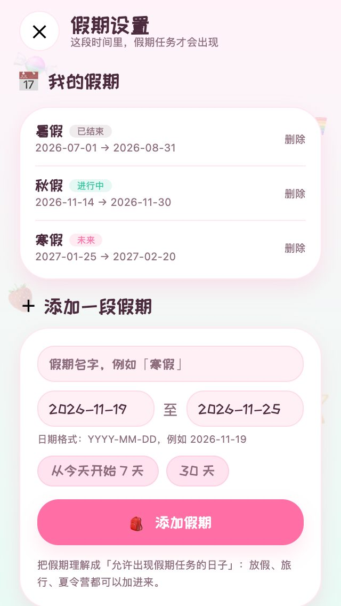

# LoulouDo · 鹿鹿打卡 🦌

> 把孩子每天要做的小事，变成一场闪闪发光的金币冒险。

LoulouDo 是一款面向 4–10 岁孩子的**跨平台（iOS / Android / Web）打卡 App**：完成每日、周末、假期和特别挑战任务赚金币，金币按家庭约定的汇率兑换零花钱；家长可以在成长报表里看到习惯的变化。

整个 App 离线运行，数据只保存在本机，不登录、无广告。

---

## ✨ 核心功能

| 功能 | 说明 |
| --- | --- |
| ✅ 今日打卡 | 任务按类别自动出现；点击圆形按钮完成，带彩纸雨 + 震动反馈 |
| 🔁 固定任务 | 每日 / 周末 / 假期任务自动重复，不需要每天新建 |
| 🎯 单次挑战 | 带起止日期的“大任务”，完成后不再出现，奖励最高 |
| 🎁 全勤宝箱 | 当天所有任务完成，自动再奖励 5 金币（取消打卡会撤回） |
| 🔥 连续打卡 | 首页展示连续天数，跨天自动计算，断签重新开始 |
| 🪙 金币体系 | 四个类别不同默认奖励，可单独调整每个任务的奖励 |
| 💰 零花钱兑换 | 汇率可调（默认 10 金币 = ¥1），兑换记录进入“金币存折” |
| 🎁 心愿存钱罐 | 设置心愿和目标金额，用余额展示进度 |
| 🎨 4 套皮肤 | 糖果星球 / 撞色波普 / 贴纸手账 / 星空梦想，全部即时切换 |
| 📊 成长报表 | 本周 / 本月 / 全部：金币柱状图、类别环图、完成率、最佳一天、家长小报告 |
| 👨‍👩‍👧 多宝贝 | 一台设备可以给多个孩子分别记录任务、金币和报表 |
| 🏖️ 假期管理 | 自定义假期日期段，假期任务只在假期出现 |
| 💾 本地持久化 | AsyncStorage 自动保存，刷新/重启不丢数据 |

### 任务规则

- **每日**：每天出现，默认 2 金币。
- **周末**：仅周六、周日出现，默认 5 金币。
- **假期**：仅在后台上设置的假期日期内出现，默认 6 金币。
- **特别挑战**：单次任务，在自己设定的日期窗口内完成一次，默认 15 金币。
- 固定任务按“日期 + 任务”记录完成；单次挑战全局只完成一次。
- 全勤金币、新手礼包等额外奖励会记录在存折中，和任务金币分开统计。

---

## 📱 界面一览

| 欢迎 & 选皮肤 | 今日打卡（撞色波普） |
| --- | --- |
|  |  |

| 全部完成 + 彩纸 | 任务清单 |
| --- | --- |
|  |  |

| 成长报表 | 家长小报告 / 类别分析 |
| --- | --- |
|  |  |

| 金币钱包 | 兑换零花钱 |
| --- | --- |
|  |  |

| 设置 & 皮肤 | 星空皮肤 |
| --- | --- |
|  |  |

| 假期设置 | 任务编辑器 |
| --- | --- |
|  |  |

> 截图全部由 `scripts/screenshots.mjs` 用真实 Chrome 跑完整交互后自动生成（见文末验证）。

---

## 📐 手机适配巡检

针对 5 种设备尺寸逐一跑完所有页面（欢迎、首页、任务、报表、钱包、设置、兑换、任务编辑、假期），
自动检测横向溢出、输入框超出屏幕、页面级横向滚动，结果：

| 设备 | 视口 | 结果 |
| --- | --- | --- |
| iPhone 15 | 393 × 852 | ✅ 0 问题 / 0 console error |
| iPhone SE | 375 × 667 | ✅ 0 问题 / 0 console error |
| 小屏 Android | 360 × 740 | ✅ 0 问题 / 0 console error |
| 极小屏 | 320 × 568 | ✅ 0 问题 / 0 console error |
| iPad 竖屏 | 768 × 1024 | ✅ 0 问题 / 0 console error |

| 320 首页 | 320 报表 |
| --- | --- |
|  |  |

| 320 设置（双列皮肤） | 320 假期日期输入 |
| --- | --- |
|  |  |

巡检中修掉的真实问题：

- 皮肤卡片宽度从 `48.5%` 改为 `48%`，避免 320/360 宽度下被挤成单列；
- “使用中”角标移到卡片右上角，不再压住皮肤描述；
- 假期开始/结束日期输入增加 `minWidth: 0`，窄屏不再溢出卡片；
- 长昵称在首页与设置页单行省略，不再挤压金币和编辑按钮；
- 平板/桌面端内容最宽 560px 居中，悬浮 TabBar 同步收窄，不会拉成一条超宽横条；
- 所有页面底部预留 132px，滚动到底时最后一张卡片在 TabBar 上方。

> 全量截图在 `docs/mobile/`，机器可读结果在 `docs/mobile/layout-report.json`。
> 复跑：`npm run media:audit`（需先 `npm run export:web` 并启动 4173 静态服务）。

---

## 🚀 运行

```bash
npm install

# Web 预览
npm run web

# iOS / Android：用 Expo Go 扫描二维码
npm start
```

构建静态 Web：

```bash
npm run export:web   # 输出到 dist/
```

> 项目使用 Expo SDK 58 + React Native 0.88，纯 JS/TS 依赖，Expo Go 可直接运行；iOS/Android 原生工程未生成（`expo prebuild` 可生成）。

### 质量检查

```bash
npm run typecheck    # TypeScript 严格模式
npm test             # Vitest 领域逻辑测试
```

### 重新生成图标 / 演示截图

```bash
npm run media:icons
# 需要先 npm run export:web 并启动静态服务（端口 4173）
npm run media:shots
```

---

## 🧠 设计与实现

### 架构

```text
app/                        Expo Router 页面（文件即路由）
  (tabs)/
    index.tsx               今日打卡
    tasks.tsx               任务清单（分类 / 编辑入口）
    report.tsx              成长报表
    wallet.tsx              金币钱包 + 存折
    settings.tsx            宝贝资料 / 皮肤 / 金币规则 / 假期
  welcome.tsx               首次启动引导
  task-editor.tsx           新建 / 编辑任务（Modal）
  redeem.tsx                兑换零花钱（Modal）
  holidays.tsx              假期日期段管理（Modal）
src/
  domain/                   纯函数领域层（可单测，不依赖 React）
    date.ts                 本地日期工具
    logic.ts                任务出现规则、金币、全勤、连续天数、报表统计
    seed.ts                 默认任务 / 假期 / 汇率
    constants.ts            类别、头像、Emoji、默认奖励
  store/AppStore.tsx        Context + useReducer + AsyncStorage 持久化
  theme/themes.ts           4 套皮肤 token + 字体
  components/               UI 基础组件 / 吉祥物 / 图表 / 彩纸 / 任务卡
tests/logic.test.ts         25 个领域逻辑测试
```

### 关键设计

1. **领域逻辑与 UI 完全分离**：任务是否出现、金币怎么算、连续天数、报表统计都是纯函数，因此边界情况（跨月、假期、单次挑战重复完成、全勤撤回）都能被单测覆盖。
2. **数据快照**：每条打卡记录保存当时的任务名、Emoji、类别、奖励和汇率，删除或修改任务不会篡改历史存折和报表。
3. **皮肤 token 化**：每套皮肤定义背景渐变、卡片、圆角、描边宽度、阴影风格、贴纸，不只是换主色；撞色波普用粗描边 + 硬阴影，贴纸手账用虚线纸感，星空用半透明卡片。
4. **纯 SVG 吉祥物**：小鹿 Loulou 由 `react-native-svg` 绘制，支持开心/庆祝/困困三种表情，不依赖图片资源。
5. **儿童友好的反馈**：大按钮、Emoji 图标、彩纸雨、震动、连续天数、全勤宝箱和会说话的小鹿。
6. **本地优先**：AsyncStorage 持久化，无账号、无网络请求，适合家庭场景。

### 默认数据

首次启动会看到 15 个示例任务（6 每日、3 周末、3 假期、3 特别挑战）、秋假/寒假/暑假三段日期，以及 **10 金币 = ¥1** 的初始汇率（可在设置中修改）。所有这些都可以修改或删除。

> 默认汇率在 `src/domain/seed.ts` 中为 **10 金币 = ¥1**（见 `settings.rate`）。
> 兑换仅记录“家庭约定”的零花钱，不接入任何支付。

---

## ✅ 验证记录

在 macOS + Node 22 + Chrome 上实际执行：

```text
$ npx tsc --noEmit
（通过，无输出）

$ npx vitest run
Test Files  1 passed (1)
     Tests  25 passed (25)

$ npx expo export -p web
Exported: dist
```

端到端脚本（Playwright + 本机 Chrome）跑通：

- 首次引导 → 填写昵称 → 选择头像 → 切换“撞色波普”皮肤 → 进入首页
- 连续完成 11 个今日任务 → 触发 **全勤宝箱**、连续 1 天、金币 98
- 报表页完成率、类别分布、家长小报告正确渲染
- 钱包中使用 50 金币兑换 ¥5.00 → 余额 48，存折新增一条记录
- 切换到“星空梦想”皮肤 → 进入假期页 → 新建任务“给植物浇水”
- 刷新页面 → 昵称、任务、皮肤（localStorage 中 `themeId: "galaxy"`）全部保留
- 全程 **0 条 console error / page error**

---

## 📌 后续可以继续做

- 打卡提醒（本地通知）与睡前温柔提醒
- 家长 PIN / 家长模式，防止孩子自己改汇率
- 周报分享卡片、成就徽章、连续 7/30 天奖杯
- iCloud / 家庭共享同步
- 语音鼓励、自定义录音
- 更多皮肤与节日限定主题

---

Made with 🍬 for small humans and their big days.
